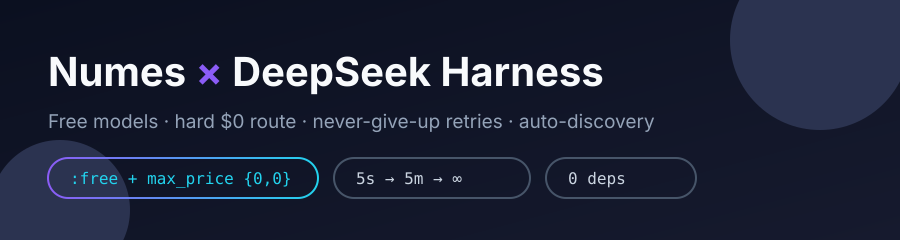
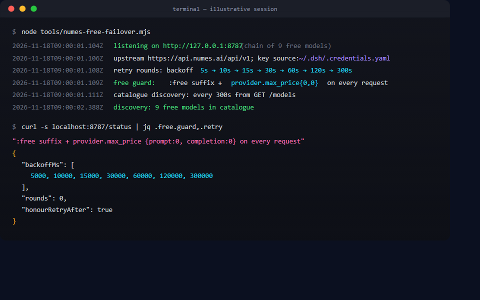
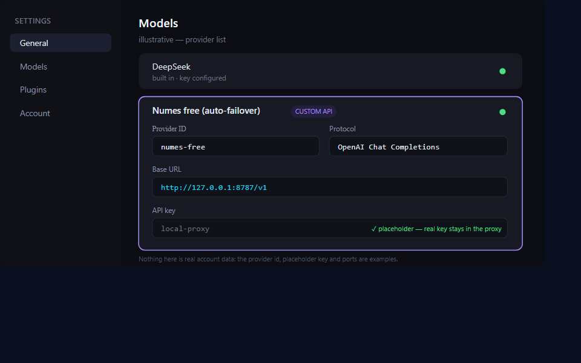
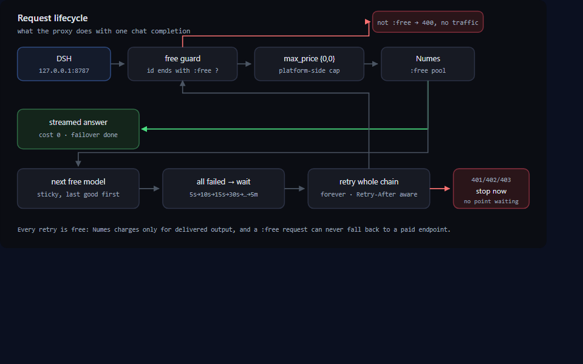

<div align="center">



# Numes × DeepSeek Harness

**Free models, smart retries, zero paid-fallback risk — as a local proxy in front of [DSH](https://github.com/deepseek-ai/deepseek-harness).**

[](https://github.com/wwewtech/numes-deepseek-harness/actions/workflows/ci.yml)
[](LICENSE)
[](tools/numes-free-failover.mjs)
[](https://nodejs.org)
[](https://numes.ai/docs/models#free-models)

[English](README.md) · **Русский** · **中文** · [Full setup (EN)](docs/SETUP.md) · [Full setup (RU)](docs/SETUP.ru.md) · [Full setup (中文)](docs/SETUP.zh.md) · [Changelog](CHANGELOG.md)

<sub>Listed in [vvlife/awesome-deepseek-harness-plugins](https://github.com/vvlife/awesome-deepseek-harness-plugins). Independent project — not affiliated with DeepSeek or Numes.</sub>

</div>

---

> ### What is this?
>
> [Numes](https://numes.ai) is an OpenAI-compatible model marketplace where some offers are **`$0`** — routed via `author/model:free`, they *cannot* fall back to a paid endpoint.
> [DeepSeek Harness](https://github.com/deepseek-ai/deepseek-harness) (DSH) is a plugin-based coding agent.
>
> This repo glues them together: **no DSH plugin needed**, one `Custom model API` form, one local proxy that never gives up and never spends a cent.

---

## ✨ What you get

| Feature | Why it matters |
|---|---|
| 💸 **Hard `$0` route** | Every model id ends with `:free`, every request carries `provider.max_price {0,0}`, and Numes guarantees `:free` never falls back to paid. **Three guards, zero charge.** |
| 🔁 **Never-give-up retries** | `503` on all free models? Wait `5s → 10s → 15s → 30s → 1m → 2m → 5m → 5m…` and walk the chain again. Exhausted free pools recover without you touching anything. |
| 🤖 **Auto-discovery** | The free-model list refreshes from `GET /models` every 5 minutes. A removed offer drops out of routing; a newly-free model joins automatically. |
| ⏱️ **`Retry-After` aware** | Numes says "wait 2s" on `429`/`503`? The proxy reads the hint and never waits *less* than the platform asked. |
| 🚫 **Smart abort** | `401`/`402`/`403` (dead key, no funds) stop the rounds immediately — retrying a rejected key is pointless noise. |
| 🔒 **Paid-model guard** | Send `moonshotai/kimi-k3.1-pro` (paid) instead of `...:free`? Instant `400` before any traffic leaves your machine. |
| 📊 **`/status` dashboard** | One request shows the guard, the live chain, the retry state, and every counter. |
| 🧩 **Zero dependencies** | One `.mjs` file, Node 18+, no `npm install`. The key is read from DSH's own credential store. |

## 🚀 Quick start (2 minutes)

> Prefer installing as a DSH bundle? `dsh plugin --profile <your-profile> add github:wwewtech/numes-deepseek-harness` — the bundle merges `cordis.patch.yml` into the profile and registers the `numes-free` provider for you. You still need to run the proxy below.

**1.** Create a Numes **inference key** at [numes.ai/dashboard/keys](https://numes.ai/dashboard/keys) (currency is permanent; free requests need a verified email).

**2.** Run the proxy:

```bash
node tools/numes-free-failover.mjs
```

```text
listening on http://127.0.0.1:8787 (chain of 9 free models)
free guard: :free suffix + provider.max_price{0,0} on every request; paid routes impossible
catalogue discovery: every 300s from GET /models
```

**3.** In DSH: **Settings → Models → Add model provider → Custom model API**

| Field | Value |
|---|---|
| Provider ID | `numes-free` |
| Base URL | `http://127.0.0.1:8787/v1` |
| Protocol | **OpenAI Chat Completions** |
| API key | any placeholder (the real key stays in the proxy) |

**4.** Pick `Numes free (auto-failover)` in the model picker. Done.

> [!TIP]
> No proxy wanted? Skip steps 2–3 and point DSH straight at `https://api.numes.ai/api/v1`, selecting the **`:free`** models yourself — see [docs/SETUP.ru.md](docs/SETUP.ru.md). The proxy only adds failover, retries, and discovery.

## 🏗️ How it works

```
                        DSH (agent, coding sessions)
                                      │  OpenAI Chat Completions
                                      ▼
                    ┌─────────────────────────────────┐
                    │  numes-free-failover  127.0.0.1:8787
                    │                                 │
                    │  guard: id ends with ":free"?   │── no ──▶ 400 refused
                    │  guard: max_price {0,0} always  │
                    │                                 │
                    │  chain: 9 free models           │
                    │  (auto-discovered, sticky)      │
                    │                                 │
                    │  all failed? ─▶ wait ─▶ retry   │
                    │  5s→10s→15s→30s→1m→2m→5m→5m…    │
                    │  (Retry-After honoured)         │
                    │                                 │
                    │  401/402/403? ──▶ stop now      │
                    └─────────────────────────────────┘
                                      │  Bearer key (never logged)
                                      ▼
                     Numes API ──▶ amazee.ai :free pool ──▶ $0
```

## 🎛️ Tuning

| Variable | Default | Meaning |
|---|---|---|
| `NUMES_PROXY_PORT` | `8787` | Listen port (`127.0.0.1` only) |
| `NUMES_CHAIN` | *(auto)* | Pin your own free-model order |
| `NUMES_PROXY_BACKOFF_MS` | `5000,…,300000` | Round delays; last repeats forever |
| `NUMES_PROXY_MAX_ROUNDS` | `0` | Give up after N rounds (`0` = never) |
| `NUMES_PROXY_DISCOVERY_MS` | `300000` | Catalogue refresh interval (`0` = off) |

## 🎯 Try it

```bash
# what's the proxy up to?
curl http://127.0.0.1:8787/status | jq .free,.retry

# a real free request
curl http://127.0.0.1:8787/v1/chat/completions \
  -H 'Content-Type: application/json' \
  -d '{"model":"auto","max_tokens":1500,"reasoning":{"effort":"none"},
       "messages":[{"role":"user","content":"Say PONG"}]}'
# → X-Numes-Free-Model: <which model answered>   X-Numes-Free-Round: 1
#   usage.cost: 0
```

## ⚠️ Honest limits

- **`$0` ≠ unlimited.** Free offers appear and vanish with provider prices; auto-discovery keeps the list current but cannot conjure capacity. If every free offer is gone, rounds keep failing *honestly*.
- **`$0` ≠ instant.** The free pool measured 50–85s to first token (short pings: ~3–8s). Set a generous `max_tokens` (1500+) — reasoning tokens eat the budget, and `max_tokens: 40` yields an empty answer with `finish_reason: "length"`.
- **`$0` ≠ private.** Providers declare their own data policies; read them before sending secrets. The proxy itself never logs your key or prompts.
- **Not a Numes or DeepSeek product.** Independent glue, verified on DSH Desktop 0.2.2-rc.3 with a USD key on 17 Nov 2026. DSH rc.4/rc.5 only change server-side search and bug fixes, not the provider setup this repo documents.

## 🖼️ Visual tour

<table>
  <tr>
    <td align="center"><strong>Terminal</strong></td>
    <td align="center"><strong>DSH Models page</strong></td>
    <td align="center"><strong>Retry flow</strong></td>
  </tr>
  <tr>
    <td></td>
    <td></td>
    <td></td>
  </tr>
</table>

<sub>🛡️ Illustrations are **mockups, not real screenshots** — no usernames, keys, or account data shown anywhere. SVG originals in [`docs/assets/`](docs/assets/); PNG rendered via headless Chrome.</sub>

---

## 📚 Everything else

| | |
|---|---|
| 🇷🇺 **Полный гайд (рекомендуется)** | [docs/SETUP.ru.md](docs/SETUP.ru.md) — от установки DSH до первого ответа, с разбором ошибок |
| 🇬🇧 Full setup guide | [docs/SETUP.md](docs/SETUP.md) — the same, in English |
| 🇨🇳 **中文全指南** | [docs/SETUP.zh.md](docs/SETUP.zh.md) — 完整安装、排错与 API 用法 |
| 🇨🇳 **中国人（README）** | [README.zh.md](README.zh.md) — 项目总览 |
| 🔧 Proxy reference | [tools/README.md](tools/README.md) — every env var, header, and behaviour |
| ⚙️ DSH config blocks | [configs/](configs/) — direct and proxy routes |
| 📦 DSH bundle | [`.dsh-plugin/manifest.json`](.dsh-plugin/manifest.json) + root `package.json` — `dsh plugin add github:wwewtech/numes-deepseek-harness` |
| 📋 Changelog | [CHANGELOG.md](CHANGELOG.md) — what changed in each version |
| 🛡️ Security & contributing | [SECURITY.md](SECURITY.md) · [CONTRIBUTING.md](CONTRIBUTING.md) |
| 🧪 **Examples** | [`examples/`](examples/) — curl, Python, PowerShell, Node, tool-calls |

## ✅ What CI checks

Every push runs [`.github/workflows/ci.yml`](.github/workflows/ci.yml), which verifies the claims made above rather than trusting them:

- the proxy parses, boots, and answers `/health` with a non-empty chain;
- the **paid-model guard really returns `400`** for a non-free id, before any network I/O;
- every relative Markdown link resolves;
- no Numes key (or GitHub token) is committed;
- each config lists only `:free` Numes ids;
- the source still contains the guard, `max_price`, backoff, `Retry-After`, discovery, and fatal-abort code the README advertises;
- the **root `package.json`** declares `dsh.bundle.patch`, `.dsh-plugin/manifest.json` references a real `cordis.patch.yml`, and the listed entry file exists;
- **7 integration tests** (`tests/proxy.test.mjs`) covering the guard, `/health`, `/status`, `/v1/models`, chain override, unknown routes and bad JSON.

Run the same checks locally:

```bash
node tools/check-repo.mjs
npm test
```

## 📄 License

[MIT](LICENSE). Not affiliated with DeepSeek or Numes. Applies Numes [ToS](https://numes.ai/legal/terms) and [AUP](https://numes.ai/legal/acceptable-use); no account automation, no quota evasion.
