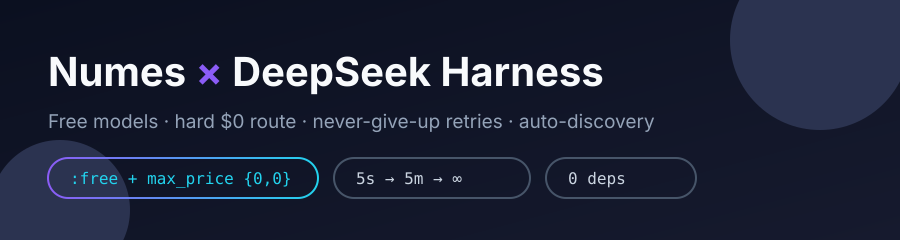
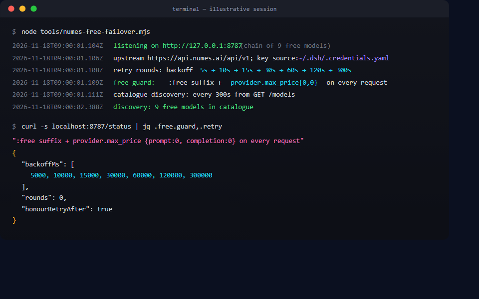
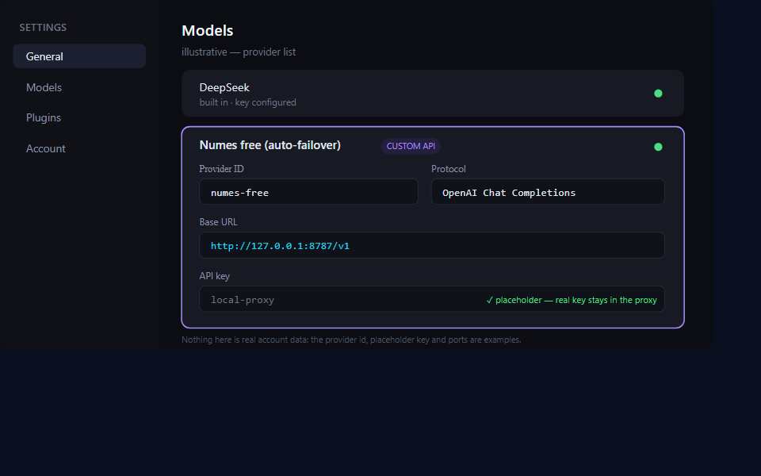
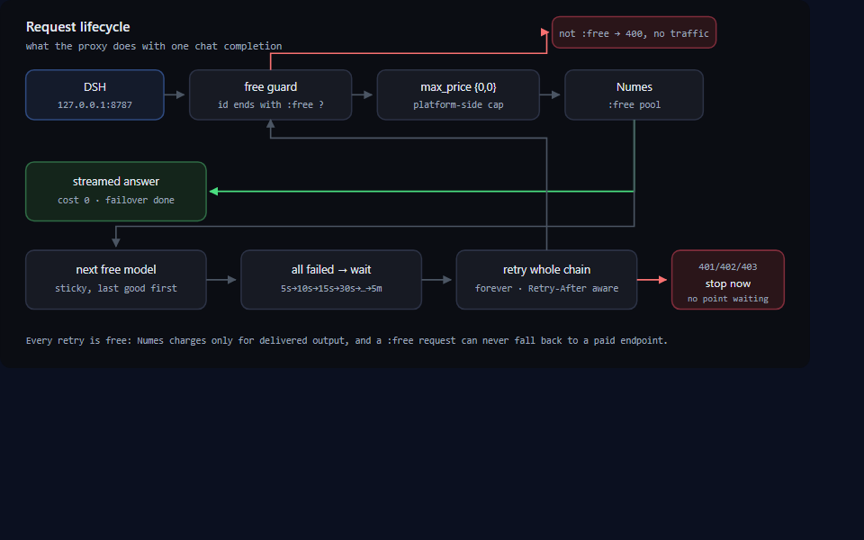

<div align="center">



# Numes × DeepSeek Harness

**免费模型，智能重试，零付费回退风险 — 作为本地代理接入 [DSH](https://github.com/deepseek-ai/deepseek-harness)。**

[](https://github.com/wwewtech/numes-deepseek-harness/actions/workflows/ci.yml)
[](LICENSE)
[](tools/numes-free-failover.mjs)
[](https://nodejs.org)
[](https://numes.ai/docs/models#free-models)

[English](README.md) · **中文** · [完整设置指南 (EN)](docs/SETUP.md) · [完整设置指南 (RU)](docs/SETUP.ru.md) · [更新日志](CHANGELOG.md)

<sub>已收录于 [vvlife/awesome-deepseek-harness-plugins](https://github.com/vvlife/awesome-deepseek-harness-plugins)。独立项目 — 非 DeepSeek 或 Numes 官方产品。</sub>

</div>

---

> ### 这是什么？
>
> [Numes](https://numes.ai) 是一个兼容 OpenAI 的模型市场，部分报价为 **`$0`** — 通过 `author/model:free` 路由，**绝不会** 回退到付费端点。
> [DeepSeek Harness](https://github.com/deepseek-ai/deepseek-harness) (DSH) 是一个基于插件的编码代理框架。
>
> 本仓库将它们连接在一起：**无需 DSH 插件**，只需一个 `Custom model API` 表单，一个永不放弃且零成本的本地代理。

---

## ✨ 核心特性

| 特性 | 价值 |
|---|---|
| 💸 **硬性 `$0` 路由** | 每个模型 ID 以 `:free` 结尾，每个请求携带 `provider.max_price {0,0}`，Numes 保证 `:free` 永不回退付费。**三重防护，零成本。** |
| 🔁 **永不放弃重试** | 所有免费模型返回 `503`？等待 `5s → 10s → 15s → 30s → 1m → 2m → 5m → 5m…` 再次遍历链。耗尽的免费池会自动恢复，无需人工干预。 |
| 🤖 **自动发现** | 免费模型列表每 5 分钟从 `GET /models` 刷新一次。移除的报价自动退出路由；新出现的免费模型自动加入。 |
| ⏱️ **`Retry-After` 感知** | Numes 在 `429`/`503` 时提示 "等待 2s"？代理读取提示且**绝不**等待少于平台要求的时间。 |
| 🚫 **智能中止** | `401`/`402`/`403`（密钥失效、无余额）立即停止轮次 — 重试被拒绝的密钥纯属无效噪音。 |
| 🔒 **付费模型防护** | 误发 `moonshotai/kimi-k3.1-pro` (付费) 而非 `...:free`？瞬间返回 `400`，流量不出本机。 |
| 📊 **`/status` 仪表盘** | 单次请求显示防护状态、实时链、重试状态及所有计数器。 |
| 🧩 **零依赖** | 单个 `.mjs` 文件，Node 18+，无需 `npm install`。密钥从 DSH 自身凭据存储读取。 |

## 🚀 快速开始 (2 分钟)

> 想用 DSH bundle 安装？执行：`dsh plugin --profile <profile> add github:wwewtech/numes-deepseek-harness`。捆绑会把 `cordis.patch.yml` 合并到目标 profile，并为你注册 `numes-free` 提供方。下面的代理仍需运行。

**1.** 在 [numes.ai/dashboard/keys](https://numes.ai/dashboard/keys) 创建 Numes **推理密钥**（货币永久；免费请求需要验证邮箱）。

**2.** 运行代理：

```bash
node tools/numes-free-failover.mjs
```

```text
listening on http://127.0.0.1:8787 (chain of 9 free models)
free guard: :free suffix + provider.max_price{0,0} on every request; paid routes impossible
catalogue discovery: every 300s from GET /models
```

**3.** 在 DSH 中：**Settings → Models → Add model provider → Custom model API**

| 字段 | 值 |
|---|---|
| Provider ID | `numes-free` |
| Base URL | `http://127.0.0.1:8787/v1` |
| Protocol | **OpenAI Chat Completions** |
| API key | 任意占位符（真实密钥留在代理中） |

**4.** 在模型选择器中选择 `Numes free (auto-failover)`。完成。

> [!TIP]
> 不想用代理？跳过步骤 2–3，直接让 DSH 指向 `https://api.numes.ai/api/v1`，自行选择 **`:free`** 模型 — 详见 [docs/SETUP.md](docs/SETUP.md)。代理仅提供故障转移、重试和发现功能。

## 🏗️ 工作原理

```
                        DSH (agent, coding sessions)
                                      │  OpenAI Chat Completions
                                      ▼
                    ┌─────────────────────────────────┐
                    │  numes-free-failover  127.0.0.1:8787
                    │                                 │
                    │  guard: id ends with ":free"?   │── no ──▶ 400 refused
                    │  guard: max_price {0,0} always  │
                    │                                 │
                    │  chain: 9 free models           │
                    │  (auto-discovered, sticky)      │
                    │                                 │
                    │  all failed? ─▶ wait ─▶ retry   │
                    │  5s→10s→15s→30s→1m→2m→5m→5m…    │
                    │  (Retry-After honoured)         │
                    │                                 │
                    │  401/402/403? ──▶ stop now      │
                    └─────────────────────────────────┘
                                      │  Bearer key (never logged)
                                      ▼
                     Numes API ──▶ amazee.ai :free pool ──▶ $0
```

## 🎛️ 调优

| 变量 | 默认值 | 含义 |
|---|---|---|
| `NUMES_PROXY_PORT` | `8787` | 监听端口（仅 `127.0.0.1`） |
| `NUMES_CHAIN` | *(auto)* | 固定你自己的免费模型顺序 |
| `NUMES_PROXY_BACKOFF_MS` | `5000,…,300000` | 轮次延迟；最后一项永远重复 |
| `NUMES_PROXY_MAX_ROUNDS` | `0` | N 轮后放弃 (`0` = 永不) |
| `NUMES_PROXY_DISCOVERY_MS` | `300000` | 目录刷新间隔 (`0` = 关闭) |

## 🎯 试用

```bash
# 代理状态
curl http://127.0.0.1:8787/status | jq .free,.retry

# 真实免费请求
curl http://127.0.0.1:8787/v1/chat/completions \
  -H 'Content-Type: application/json' \
  -d '{"model":"auto","max_tokens":1500,"reasoning":{"effort":"none"},
       "messages":[{"role":"user","content":"Say PONG"}]}'
# → X-Numes-Free-Model: <哪个模型响应>   X-Numes-Free-Round: 1
#   usage.cost: 0
```

## ⚠️ 诚实限制

- **`$0` ≠ 无限。** 免费报价随供应商价格出现和消失；自动发现保持列表最新但无法凭空创造容量。如果所有免费报价都没了，轮次会**诚实地**持续失败。
- **`$0` ≠ 即时。** 免费池首 token 测得 50–85s（短 ping：~3–8s）。设置充足的 `max_tokens` (1500+) — 推理 token 吃预算，`max_tokens: 40` 会导致空回答并 `finish_reason: "length"`。
- **`$0` ≠ 隐私。** 供应商自行声明数据政策；发送机密前请阅读。代理本身从不记录你的密钥或提示词。
- **非 Numes 或 DeepSeek 产品。** 独立胶水层，在 DSH Desktop 0.2.2-rc.3 + USD 密钥上验证 (17 Nov 2026)。DSH rc.4/rc.5 仅改变服务端搜索和修复，不影响本仓库文档的 provider 设置。

## 🖼️ 视觉预览

<table>
  <tr>
    <td align="center"><strong>终端</strong></td>
    <td align="center"><strong>DSH Models 页面</strong></td>
    <td align="center"><strong>重试流程</strong></td>
  </tr>
  <tr>
    <td></td>
    <td></td>
    <td></td>
  </tr>
</table>

<sub>🛡️ 插图为 **模拟图，非真实截图** — 无用户名、密钥、账号数据。SVG 源文件在 [`docs/assets/`](docs/assets/)；PNG 经 headless Chrome 渲染。</sub>

---

## 📚 其它资源

| | |
|---|---|
| 🇷🇺 **完整指南 (推荐)** | [docs/SETUP.ru.md](docs/SETUP.ru.md) — 从安装 DSH 到首次响应，含错误分析 |
| 🇬🇧 Full setup guide | [docs/SETUP.md](docs/SETUP.md) — same, in English |
| 🔧 Proxy reference | [tools/README.md](tools/README.md) — 所有环境变量、头、行为 |
| ⚙️ DSH config blocks | [configs/](configs/) — direct and proxy routes |
| 📋 Changelog | [CHANGELOG.md](CHANGELOG.md) — 每个版本的变更 |
| 🛡️ Security & contributing | [SECURITY.md](SECURITY.md) · [CONTRIBUTING.md](CONTRIBUTING.md) |
| 🧪 **Examples** | [`examples/`](examples/) — curl, Python, PowerShell, Node, tool-calls |

## ✅ CI 检查什么

每次推送运行 [`.github/workflows/ci.yml`](.github/workflows/ci.yml)，验证上述声明而非盲目信任：

- 代理解析、启动、返回 `/health` 且链非空；
- **付费模型防护真正对非 free id 返回 `400`**，在任何网络 I/O 前；
- 所有相对 Markdown 链接可解析；
- 未提交 Numes 密钥（或 GitHub token）；
- 每个配置仅列出 `:free` Numes id；
- 源码仍包含 guard、`max_price`、backoff、`Retry-After`、discovery、fatal-abort 代码。

本地运行相同检查：

```bash
node tools/check-repo.mjs
```

## 📄 许可证

[MIT](LICENSE)。非 DeepSeek 或 Numes 官方产品。适用 Numes [ToS](https://numes.ai/legal/terms) 和 [AUP](https://numes.ai/legal/acceptable-use)；禁止账号自动化、配额规避。